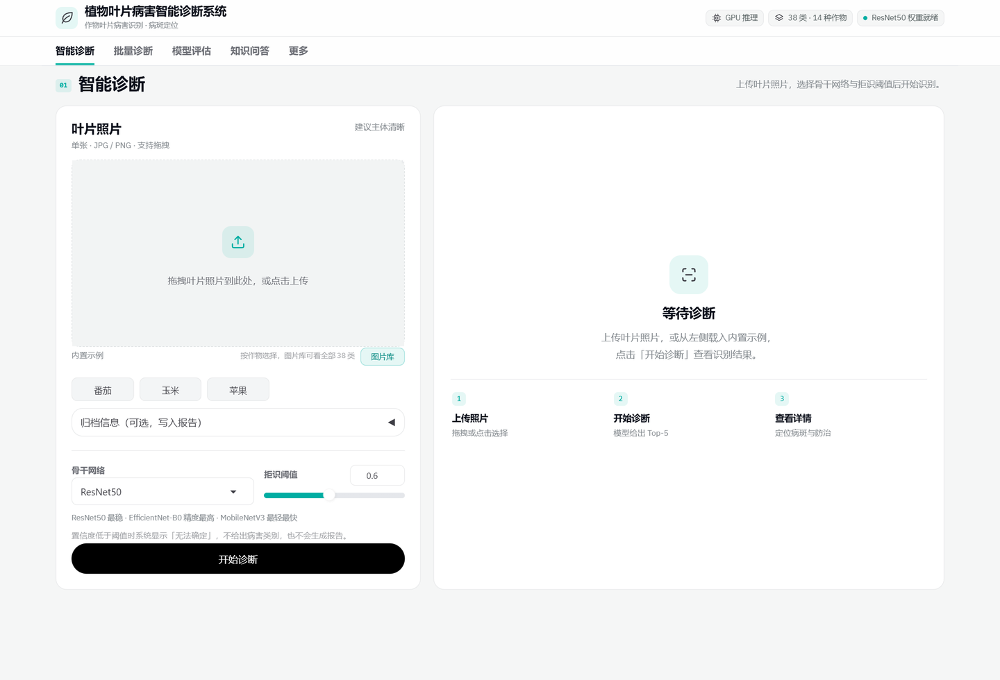
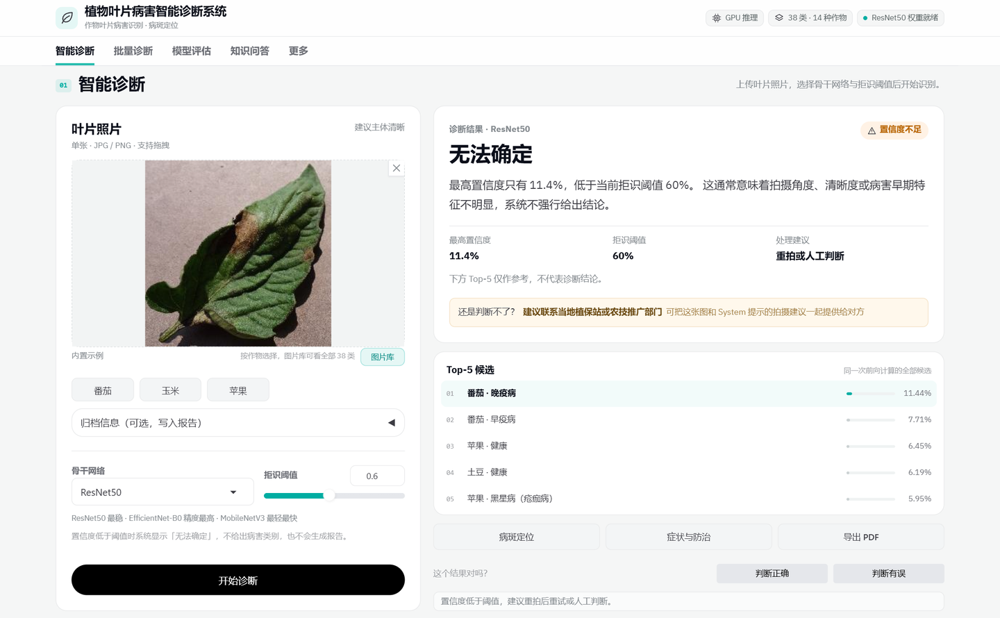
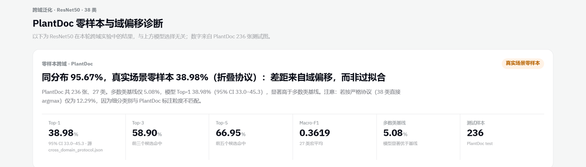

# 作物叶片病害识别

作物叶片病害识别、跨域落差量化、本地知识问答。从训练、评估到 Gradio 界面都在这个仓库里。





*番茄晚疫病示例图的置信度 11.44%，低于 60% 的拒识阈值，系统判「无法确定」并保留 Top-5 候选。*

## 它做什么

ResNet50 在 PlantVillage 上训练，同分布测试集 95.67%（265/277）。同一份权重不做任何适配，拿去测互联网真实照片 PlantDoc，零样本 12.29%（29/236）；把 38 类概率按 1:1 映射折叠到 PlantDoc 的 27 类再取 argmax，是 38.98%（92/236，Wilson 95% CI 33.0–45.3）。

落差本身就值得写下来：模型没有过拟合训练集，它拟合的是实验室的拍摄方式。受控偏移谱把主因定位到目标尺度，背景颜色不是主因。仓库把这件事拆成评估协议、风险—覆盖曲线、一致性分层和域偏移诊断，再补上 AdaBN、域随机化、混合域微调三条补救脚本。

界面上单张与批量诊断、病斑定位、模型评估、本地知识问答都能用；问答走本地 bge + BM25 检索，没有 API Key 也能答。分类按 PlantVillage 的 38 类 / 14 作物训练，知识库覆盖 2,645 条 / 66 作物，问答层比分类层宽，用来回答「这是什么病、怎么防」。

## 快速开始

需要 Python ≥ 3.10（Gradio 6 的下限）；本仓库在 3.13 + PyTorch 2.6 上实测，GPU 可选。

```bash
git clone https://github.com/zhangjingtong000/plant-disease-vision.git
cd plant-disease-vision
pip install -r requirements.txt
```

数据与权重不随仓库提供，需要按下面的目录自行准备：

```
data/parquet/           PlantVillage parquet（train-00000/00001、test-00000）
data/splits.json        类别名、作物映射、样本清单
data/images/<类别>/     prepare_data.py 生成的配平图片
data/plantdoc_extract/  PlantDoc 测试图
outputs/checkpoints/    <backbone>_best.pth
assets/embedding/       bge-small-zh-v1.5
```

| 数据 | 来源 |
|---|---|
| PlantVillage | <https://github.com/spMohanty/PlantVillage-Dataset> |
| PlantDoc | <https://github.com/pratikkayal/PlantDoc-Dataset> |
| CropDP-KG（扩充知识库来源，2,536 条） | <https://github.com/dadadaray/CropDP-KG> |
| bge-small-zh-v1.5 | <https://huggingface.co/BAAI/bge-small-zh-v1.5> |

有数据后，训练、评估、界面：

```bash
python scripts/prepare_data.py              # parquet → 配平图片 + splits.json
python src/train.py --model resnet50 --epochs 25   # 需要 GPU
python src/predict.py --split test          # top-1 / top-3
python src/cross_domain_protocol.py         # 跨域三种协议，需要 PlantDoc
python app/web_agent.py                     # http://127.0.0.1:7860
```

没有权重也能起界面：顶部标「权重未找到」，诊断页提示缺 checkpoint，知识问答、图片库和读 `results/` 的评估面板照常可用。缺 `data/splits.json` 会在启动前以退出码 2 结束，不抛裸 traceback。没有数据时 `python -m pytest -q` 仍会跑规则、前置检查与训练冒烟这些不依赖图片的用例。

Windows 上也可以双击 `start_local.bat`，或用 `pwsh ./run_all.ps1` 依次跑训练三骨干、评估出图、性能基准、退化鲁棒、遮挡五步；跨域三协议与三条补救脚本不在这个脚本里，按上面的命令单独跑。

## 功能

| 模块 | 能力 |
|---|---|
| 智能诊断 | 单张上传或内置示例；ResNet50 / EfficientNet-B0 / MobileNetV3 切换；拒识阈值；Top-5；Grad-CAM 病斑定位；PDF 报告 |
| 批量诊断 | 目录批处理、逐张详情浮层、CSV 导出 |
| 模型评估 | 同分布指标、评估图表、三骨干对比、跨域泛化面板、数据资产 |
| 知识问答 | bge 向量 + jieba / BM25 混合召回；5 类意图分类；越界作物拒答；无 Key 降级为返回原文 |
| 跨域实验 | 严格 / 折叠协议、风险—覆盖曲线、多模型一致性分层、受控偏移谱 |
| 训练与数据 | 三骨干训练、配平划分、冒烟子集抽样、1-step 训练测试 |

界面是一个 Gradio 应用：`app/web_agent.py` 负责布局与交互（五个页签），`app/web.py` 是推理后端，两个文件复用同一条 `infer` 路径。评估页的数字从 `outputs/metrics/` 优先、`results/` 兜底读取，缺产物时显示「—」而不是 0.00%。

## 跨域实验

PlantDoc 测试集 236 张、27 类。同一份 ResNet50 权重，三种口径：

| 设置 | 准确率 | n | Wilson 95% CI | 出处 |
|---|---|---|---|---|
| 同分布测试（PlantVillage） | 95.67%（265/277） | 277 | 92.6–97.5 | `results/cross_domain_resnet50.json` |
| PlantDoc 零样本（38 类直接 argmax） | 12.29%（29/236） | 236 | 8.7–17.1 | `results/cross_domain_diag.json` |
| PlantDoc 折叠协议（映射到 27 类） | 38.98%（92/236） | 236 | 33.0–45.3 | 同上 |



折叠协议的 Top-5 是 66.95%，多数类基线 5.08%。95.67% 的分母是 277，另有 98.52%（1064/1080）和 98.61%（1490/1511）两个不同评测集，口径见 `docs/实验记录.md`。

三行 CI 都由计数按 Wilson 公式算出；95.67% 的原始 `eval_resnet50.json` 未随仓库提供，265/277 取自 `cross_domain_resnet50.json` 的 `in_domain_accuracy`。另有两个旁证：受限协议与折叠协议在 1:1 映射下等价，236 张样本上预测差异为 0（`results/cross_domain_protocol.json`）；域判别器 5 折 CV 94.81%，两个域线性可分（`results/domain_classifier.json`）。

## 最小复现

全量实验要 16 GB 的 PlantVillage parquet 和 GPU。只验证链路时，8 类 × 40 张就够，原始输出在 `results/smoke_minimal.json`。

```bash
python scripts/make_smoke_subset.py --src-parquet <完整 parquet 目录>
python scripts/prepare_data.py
python src/train.py --model resnet50 --epochs 3 --batch 16 --workers 2
python src/predict.py --split test
```

| 项 | 实测 |
|---|---|
| 数据 | 8 类 × 40 张 = 320 张；train / val / test = 224 / 32 / 64 |
| 训练 | ResNet50 3 轮，57.1 s，train_loss 3.3411 → 2.2120，val_acc 78.1% |
| 测试 | 64 张 top-1 84.4%、top-3 100% |
| 推理 | 预热后 11.2 ms/张（RTX 4060，batch=1） |

这是链路冒烟的指标，不能和 95.67% 并列。

## 实验产物

`results/` 下 6 个 JSON 是 README 里数字的出处：

| 文件 | 内容 |
|---|---|
| `cross_domain_diag.json` | 严格 12.29%、折叠 38.98%、Wilson CI、Top-5、风险—覆盖、一致性分层 |
| `cross_domain_protocol.json` | 受限与折叠协议逐样本对比（差异 0） |
| `cross_domain_resnet50.json` | 域内准确率 0.9567 与 PlantDoc 逐类准确率 |
| `domain_classifier.json` | 域判别器 5 折 CV 0.9481 |
| `smoke_minimal.json` | 冒烟链路：数据、训练曲线、推理耗时 |
| `benchmark.json` | 三骨干在 RTX 4060 上的延迟与体积（旧 127 类模型） |

## 设计要点

- **评估协议**：初版拿全类 argmax 对 PlantDoc 标签，12.29% 系统性低估；折叠到 27 类后是 38.98%。受限协议（只在可映射类里取 argmax）在这个 1:1 映射下与折叠等价，实测 236 张预测差异 0，所以只报一个数。
- **风险—覆盖与一致性分层**：按置信度排序弃答，覆盖 30% / 50% / 70% / 90% 时准确率 52.9% / 49.2% / 41.2% / 38.2%；多模型一致组 65%（n=80），不一致组 25.6%（n=156），骨干之间的分歧可以当免训练的拒识信号。
- **意图分类**：450 条 5 类样本（occurrence / control / symptom / compare / system），bge 句向量 + 标准化 + 逻辑回归，5 折 CV 0.9711 ± 0.0166；模型文件缺失时回退关键词规则，问答不中断。
- **检索降级**：检索必有、生成可选。没有 API Key 或断网时返回知识原文；作物不在白名单、病害不在知识库里时回答「超出范围」，不拿最接近的条目硬套。

## 已知边界

- 数据集、权重、检索向量模型都不在仓库里，`data/`、`outputs/`、`assets/embedding/` 需自备。
- PlantDoc 只有 236 张、单一目标域，CI 宽约 12 个百分点，跨域数字读作量级与方向。
- 95.67% / 98.52% / 98.61% 来自三个不同评测集，不能互换，README 只把 95.67% 当主口径。
- `results/benchmark.json` 量的是旧的 127 类模型，9.16 ms / 109.2 张每秒只作同代骨干的量级参考；当前 38 类冒烟模型 11.2 ms/张（`results/smoke_minimal.json`）。
- AdaBN、域随机化、混合域微调的脚本在 `src/`，度量产物未随仓库提供，这里不报它们的准确率。

## 目录结构

```
plant/
├── app/                 Gradio 界面（web_agent.py 界面层，web.py 推理后端）
├── src/                 训练、评估、跨域实验、检索问答、知识库
├── scripts/             数据准备、冒烟子集抽样
├── tests/               pytest 用例，按数据 / 权重 / 界面分级跳过
├── results/             所有被引用的实验 JSON
├── docs/                实验记录与界面截图
├── assets/samples/      4 张示例叶片图
└── requirements.txt
```

## 测试

`python -m pytest -q`：本机（完整数据 + resnet50 权重）40 passed / 4 skipped；无数据环境只跑不需要图片和权重的用例。`tests/conftest.py` 在收集阶段按「有没有数据 → 数据够不够完整 → 有没有权重 → 界面能不能起」决定收集哪些文件，缺权重是 skip 而不是 fail。

## 技术栈与许可

PyTorch 2.6 / torchvision、ResNet50 · EfficientNet-B0 · MobileNetV3-Large、Grad-CAM、Gradio 6、jieba + rank-bm25 + bge-small-zh、scikit-learn、ReportLab、PyArrow。

代码以 MIT 发布，见 `LICENSE`。`src/knowledge_kg.py` 的 2,536 条文本整理自 CropDP-KG，`assets/samples/` 的图片来自 PlantVillage，再分发须遵守各自许可；数据集不在仓库内。
